 

  <a href="https://bautistaquereda.dev"><code>[ $ open bautistaquereda.dev ]</code></a>&nbsp;
  <a href="https://www.linkedin.com/in/bautistaquereda/"><code>[ linkedin ]</code></a>&nbsp;
  <a href="mailto:bautistaquereda@gmail.com"><code>[ mail ]</code></a>&nbsp;
  <a href="https://bautistaquereda.dev/cv/Bautista-Quereda-BackendDev-CV-ENG.pdf"><code>[ $ wget cv_en.pdf ]</code></a>&nbsp;
  <a href="https://bautistaquereda.dev/cv/Bautista-Quereda-BackendDev-CV-ESP.pdf"><code>[ $ wget cv_es.pdf ]</code></a>

